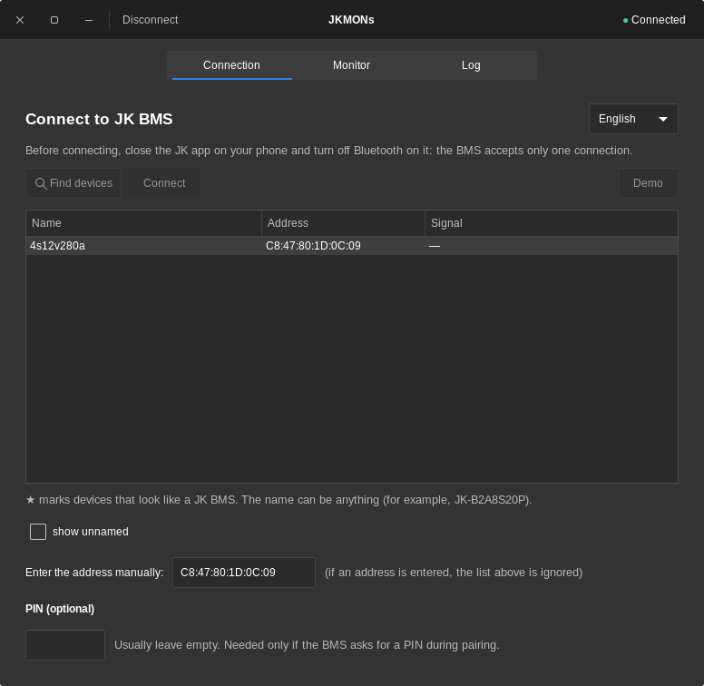
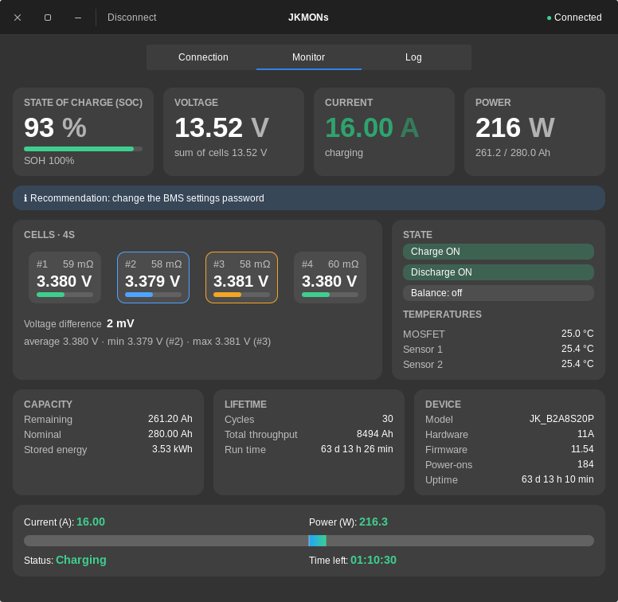

# JKMONs — a GTK3 monitor for JK BMS on Linux

One window for both the connection and the monitor: SOC, pack voltage, current, power, cell voltages and
resistances, temperatures, balancing, MOSFET state, error flags, and a load bar with an estimated time to full
charge or empty. No browser needed.
Read-only: the app only sends data requests to the BMS and never switches anything.

<p>
  
  
</p>

## Install: option 1 — deb package (recommended for Mint / Ubuntu / Debian)

```bash
bash build_deb.sh
sudo apt install ./jkmons_*.deb
```

This adds a "JKMONs" entry to the menu and the `jkmons` command. apt installs GTK3, python3-gi and bluez for you.
The bleak/dbus-fast libraries live in the package's private folder, so they do not conflict with system packages.
Remove with `sudo apt remove jkmons`. If the app stops starting after a major Mint upgrade (a new Python version),
build and install the package again with the same commands.

## Install: option 2 — AppImage

```bash
bash build_appimage.sh
./JKMONs-x86_64.AppImage
```

A single file, no installation (right-click → Properties → Permissions → "Allow executing file as program").
GTK3 is taken from the system, so the file is meant for the same distribution it was built on.

## Run without installing

```bash
sudo apt install python3-gi python3-gi-cairo gir1.2-gtk-3.0 bluez
python3 -m pip install --user --break-system-packages -r requirements.txt
python3 jkmon_gtk.py
```

## Interface language

English by default. Pick the language from the dropdown on the Connection tab, to the right of the heading
(English / Українська / Русский). It changes instantly, without a restart, and is remembered. To change it while
the monitor is running, press "Disconnect" and open the Connection tab. A new language is added to `i18n.py`
as one more column in the `_ROWS` table.

The window size (and the maximized state) is remembered between runs; settings are stored in
`~/.config/jkmon/config.json`.

## How to use

Tabs at the top: **Connection**, **Monitor**, **Log**. The connection status and the **Disconnect** button are in
the window's title bar.

1. Close the JK app on your phone and turn off Bluetooth on it: the BMS accepts only one connection.
2. On the Connection tab press **Find devices** (magnifier icon) and pick your BMS in the table (★ marks devices
   that look like a JK BMS; the name can be anything; the table shows 10 rows and scrolls beyond that), or enter the
   address manually under the table. The "show unnamed" checkbox next to it lists devices without a name.
3. Leave the **PIN** field at the bottom empty: the BMS does not require Bluetooth pairing.
4. Press **Connect** (next to the search button) or double-click a row in the table. After a successful connection
   the **Monitor** tab opens. **Disconnect** returns to the Connection tab. **Demo** (on the right) shows test data.

## Troubleshooting

- The connection hangs: `bluetoothctl remove <address>`, then `sudo systemctl restart bluetooth`;
  make sure the JK app on your phone is fully closed.
- Frequent reconnects usually mean a weak signal: move the PC or the Bluetooth adapter closer to the battery
  (a USB extension cable helps) and avoid USB 3.0 ports next to the adapter.
- The **Log** tab shows the reason for a failure; the full log is in `~/.cache/jkmon/jkmon.log`.
- Bluetooth is off: `bluetoothctl power on`.
- Check the libraries: `python3 jkmon_gtk.py --selftest`.
- No icon in the panel: the window provides its icon in several sizes; if the panel still shows a default icon,
  restart the panel (`cinnamon --replace &`), or install the deb package (it also provides a menu entry).

## About error flags

The status plaque above the cards shows the known flags one at a time, switching every 3 seconds, so it always takes
one line. Confirmed with the JK app: bit 4 is "Cell OVP" (a cell reached the overvoltage threshold, which normally
means the end of charging) and bit 19 is a recommendation to change the BMS settings password. Both are shown as
blue notices, not alarms. Flags with an unknown meaning are not shown in the window: they are written to the **Log**
tab and to `~/.cache/jkmon/jkmon.log` as "BMS flags 0x... (bit N: unknown meaning)". To add a name, put it into
`ERROR_NAMES` in `jkcore.py`, for example `{19: "text from the JK app"}`; add the bit to `INFO_BITS` if it is only
a notice.

## Load bar

The bar under the cards shows the power: zero in the middle, charging to the right, discharging to the left.
100% of the bar is the 1C power, that is the nominal capacity (Ah) times the nominal voltage (V) of the pack.
For LiFePO4 the nominal cell voltage is 3.2 V, so 4S 280 Ah gives 12.8 V x 280 Ah = 3584 W
(8S: 25.6 V, 16S: 51.2 V).
The cell count and the capacity are read from the BMS; if the cells are outside the LiFePO4 range
(2.4-3.7 V per cell), the measured pack voltage is used instead. No scale values are shown.
The scale is set when the connection is made.

## Icon

`jkmon.svg` (and `jkmon.png`) are the only icon sources. The sizes for the menu and the panel are rendered at build
time by `make_icons.py`, and the window icon is rendered from the SVG when the program starts.

## Credits and sources

- **Protocol (JK02_32S):** the 20-byte request frames, the 300-byte response frames and the field offsets come from
  the open-source project [syssi/esphome-jk-bms](https://github.com/syssi/esphome-jk-bms). Only the facts about the
  format were used; the code in this repository is written from scratch.
- **Tested hardware:** JK_B2A8S20P, hardware 11A, software 11.54, a 4S 280 Ah LiFePO4 pack. Other JK models may use
  a different frame layout.
- **Error flags:** the names of bits 4 ("Cell OVP") and 19 (settings password recommendation) were confirmed by
  comparing with the JK Android app on the author's own battery. No other bit names are guessed.
- **Libraries:** [bleak](https://github.com/hbldh/bleak) (Bluetooth LE client) and
  [dbus-fast](https://github.com/Bluetooth-Devices/dbus-fast) (D-Bus, optional PIN agent), both MIT licensed;
  [PyGObject](https://pygobject.gnome.org/) with GTK 3 (LGPL) for the window; [BlueZ](http://www.bluez.org/) is the
  Bluetooth stack of the system.
- **Icon:** `jkmon.svg` / `jkmon.png` were supplied by the project author. It is not part of any license that may
  cover the code.
- **Trademarks:** "JK", "Jikong" and "JK BMS" belong to their owners. This is an independent project, not affiliated
  with or endorsed by Jikong.
